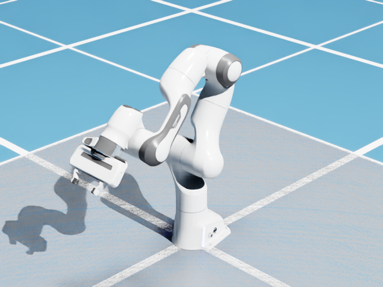
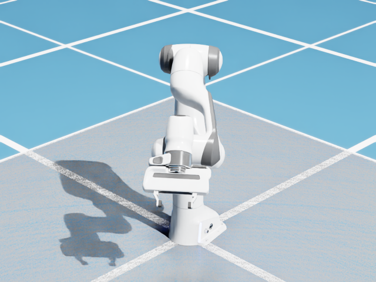

# MCP 6.2 全功能检验记录

> 本页保留初轮历史结果。**最新完整范围验收见 [MCP_6_2_ACCEPTANCE.md](MCP_6_2_ACCEPTANCE.md)**：
> 706 项离线测试通过；legacy 136 / 138、full 158 / 160 已有成功实机覆盖，另外两项按用户要求排除。

日期：2026-11-12。基线：`0325a9c540c3749da7747d99b2753afc0901f1c6`。

## 结论

**本轮检验和 MCP 内发现的问题修复已完成，但不是“所有功能全部通过”。**

- 离线：**694 passed，53 deselected**；排除的是 live / Unix launcher 标记，不是隐藏失败。
- 全仓库 Ruff、`git diff --check` 通过。
- Windows 正常/监督启动器：18 项通过，已包含在上述离线结果中。
- 实机：28 个验收域中，26 个最终通过；ROS 2 缺依赖，多机器人/Kaya 组合遇到原生 CUDA 故障，未通过。
- `legacy` 的 138 个工具：**114 个有成功实机覆盖，24 个外部依赖受阻**。
  其中 70 个走实际 MCP 客户端，44 个走扩展命令及操作后读回；后者的 MCP 参数路由另外由离线契约覆盖。
- `full` 的 160 个名字（包含 22 个合并入口）：134 个有成功实机覆盖，26 个依赖受阻。
  合并入口也通过实际 `consolidated` 客户端运行；该 profile 暴露 107 个工具。
- stdio 与 Streamable HTTP 均完成真实 MCP 请求、相机 ImageContent 和清理验证。

逐项状态与证据域见 [FULL_MCP_6_2_RESULTS.json](FULL_MCP_6_2_RESULTS.json)。
“覆盖”只代表记录中的参数、场景和后置条件，不代表所有机器人型号、物理后端或参数组合均通过。

## 环境与范围

- 实际宿主报告版本：**Isaac Sim 6.2.0-rc.14**，Windows，PhysX；不能把它称为另一个正式版构建。
- 使用独立进程、19876 端口、临时 USD 与独立日志；正式 GUI 的 8876 端口未用于写入测试。
- 代码先在 detached worktree 修改，用户保存关闭正式 GUI 后才部署回本地 `main`。
- 仅修改本 MCP 库。隔离宿主中的 `sany.granular_mpm`、`bauma.save_to_source` 始终禁用。
  不升级、不修补、不启用外部插件，不访问用户正式 USD，不保存用户场景。
- Newton、Linux/Unix 启动器和外部服务正向调用不在本轮通过范围。

## 实际修复

1. **暂停/单步后的相机旧帧**：相机原来只在缓存为空时请求渲染，已有缓存会被反复返回。
   现在暂停态每次捕获都等待一个新的异步渲染结果；`delta_time=0`，不为截图推进仿真。
2. **单步物理与画面不同步**：步进后按当前配置更新 Fabric；未启用 Fabric 的 PhysX 路径更新 USD 变换和速度。
   不擅自启用 Fabric，不改后端或 GPU 全局配置。
3. **执行普通脚本隐式启动物理**：`execute_script` 不再先初始化原生物理。
   只读取配置或编辑 USD 的脚本不应在停止的时间轴背后启动模拟；需要物理的命名工具仍自行初始化。
4. **无效 USD 假成功**：加载前解析源层并验证 defaultPrim；失败保留异常原因，不再用错误字典充当成功 prim 路径。
   实机验证有效文件可组合、无效文件报错且不留下目标空 prim。
5. **SDG 无输出仍“完成”**：完成状态必须有请求数量的实际标注帧。
   空输出、少帧或已有清理错误转为 error，状态与 manifest 保持一致。新增 0/1/2 帧回归。
6. **验收基础设施**：修复新模块使报告生成器崩溃、旧快照计数误用、装饰器 annotations 测试夹具、
   旧接口/文档断言、运行身份缓存串扰、Python 3.10 f-string 语法及 import lint。
   live 脚本使用配置端口和 6.2 断言；修正相机显式后台许可、managed artifact 句柄、运动初始姿态读取竞态、
   SDG 验证失败时的 owned-job 清理。

## 功能覆盖

已通过的域包括：命令治理/幂等性、任务/诊断、USD 组合/批量预览与提交/撤销/分页/保存重开、
刚体/碰撞组/关节/物理材质/物理参数、对象/克隆/PBR/灯光/语义/属性、有效与无效 USD 加载、URDF 导入、
NVIDIA 资产和环境、机器人目录、关节位置/驱动配置、IK/规划/执行/取消/超时、
独立 Panda 夹爪与 Jetbot 差速控制、OmniGraph/ScriptNode 生命周期、Replicator SDG、
RGB/多种相机输出/标定、LiDAR 配置与点云、传感器删除和重建、artifact 分块/校验/过期/删除、
原生 ImageContent、合并工具入口、stdio/HTTP 传输。

### 两帧视觉与读回

Panda 第一个关节从约 `0 rad` 移至 `0.699 rad`，目标 `0.7 rad`；
分别步进 120 帧后捕获，检查关节容差、像素变化比例并人工查看两张实际 MCP 图片。
修复前读数已变化但两图姿态相同；修复后姿态、方向、阴影与读回一致。

| 前 | 后 |
|---|---|
|  |  |

### 未通过及限制

| 项目 | 结果与处理 |
|---|---|
| 6 个 ROS 2 发布/删除工具 | bridge/core/nodes 未启用；状态/列表与缺依赖响应已检查，没有自动启用。 |
| 9 个人物/导航操作 | Actor/Navigation 依赖未启用；纯 USD 人物列表可读，不能因此宣称人物动画/寻路通过。`spawn_human` 可能自动启用依赖，所以未执行。 |
| 5 个 MPM 桥接工具 | 只检查禁用 provider 时的 `MPM_EXTENSION_DISABLED`，未运行外部粒子插件。 |
| 2 个源文件提交桥接工具 | 只检查 `SOURCE_PROVIDER_UNAVAILABLE`，未运行保存插件。USD 批量事务的原生撤销另已通过。 |
| USD Search、Beaver3D | 缺 API 配置，验证明确失败响应；没有付费请求。 |
| Panda + Jetbot + Kaya 混合 GPU 场景 | 三次尝试均在原生 PhysX 启动/模拟阶段出现 CUDA 700，随后 Kaya 操作无法分配 CUDA 资源。停止该组合测试并重启隔离宿主，后续不使用污染进程的结果。未证明根因属于 MCP，也未修改 Isaac/PhysX/驱动或切换 CPU 掩盖问题。独立 Panda 和 Jetbot 后续通过，不代表 Kaya 或混合场景已修好。 |

## 日志、复测与证据

- 初轮 618 passed / 67 failed；主要为过时契约/测试夹具，也暴露报告生成器问题。
- 中途的 UTF-8 环境缺失、worktree 缺 `.venv` 链接、端点身份缓存污染均已分别定位，不能当成宿主功能失败。
- 修复后的完整离线最终结果：694 passed / 53 deselected；未删除失败用例或降低业务断言来凑通过。
- 最新正常宿主日志中的 OmniGraph `MCP_ERROR_F` 是故意注入并由验收检查到的 ScriptNode 错误；
  对应恢复、删除、异步错误计数和时间轴读回通过。早期原生 CUDA 700 保留为失败证据，未混入通过记录。
- 本地原始日志、调用 trace、JUnit、图片及失败尝试保留在
  `test_outputs/full-mcp-20261112-130431/`（ignored，不自动发布原始机器日志）。
- `docs/research/ALL_TOOLS_TEST_REPORT.md` 是历史证据聚合，不等于本轮 6.2 结论；以本记录及同名 JSON 为准。
- Git 变更前另存了 bundle；本轮不创建额外分支，不自动 push/tag/release。

## 重复运行

离线命令（安装好仓库 `.venv`；中文 Windows 明确使用 UTF-8）：

```powershell
$env:PYTHONUTF8 = '1'
$env:ISAAC_MCP_TOOL_DOMAINS = 'all'
$env:ISAAC_MCP_TOOL_PROFILE = 'legacy'
.venv\Scripts\python.exe -m pytest -q -m "not live and not unix_launcher"
.venv\Scripts\ruff.exe check isaac_mcp isaac.sim.mcp_extension scripts tests
```

实机必须先建立专用隔离宿主和临时场景，不能把这些脚本指向正在编辑的用户场景。
本轮补充脚本为 `verify_core_surface_live.py`、`verify_robot_visual_live.py`、
`verify_controller_singletons_live.py`、`verify_profiles_live.py`、`verify_alias_jobs_live.py`。
设置 `ISAAC_MCP_PORT` 和 `ISAAC_MCP_VALIDATION_ROOT`，后者必须与宿主日志父目录及当前临时 USD 所在目录一致。
运行时需要 `PYTHONPATH` 指向仓库。每组更换 verifier-owned 场景，失败后先检查进程/日志再决定是否继续。

artifact 过期专项使用隔离进程环境 `ISAAC_MCP_ARTIFACT_TTL_SECONDS=30`、
`ISAAC_MCP_ARTIFACT_MAX_CHUNK_BYTES=1024`；相机后台更新专项另需显式
`ISAAC_MCP_SCRIPT_ALLOW_BACKGROUND=true`。这些只作用于测试进程，不修改正式配置。
