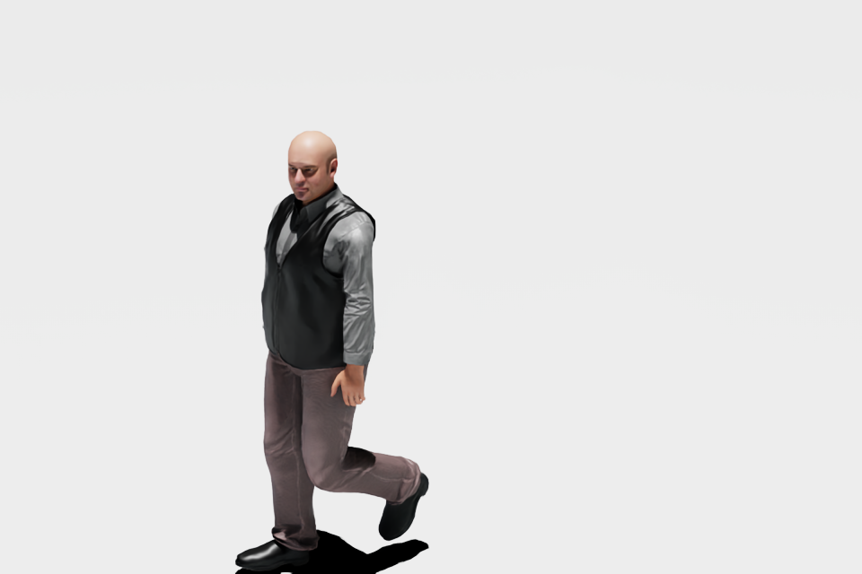
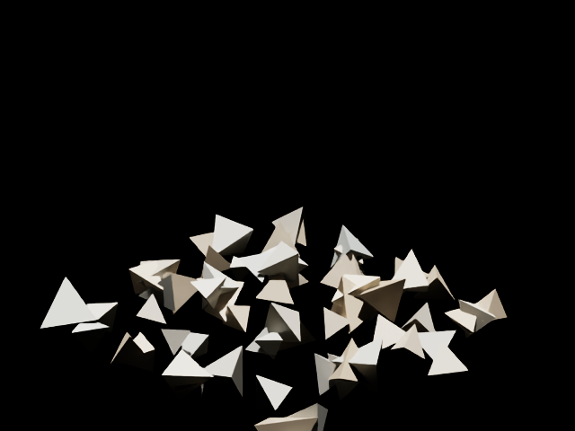

# MCP 6.2 最终验收

日期：2026-11-12；本轮修改基线：`cb53025`。本记录更新此前两轮报告的外部依赖结论，历史失败证据保留。

## 结论

**用户约定的验收范围已通过。USD Search、Beaver3D 按用户要求不调用，明确保留未验收。**

- 离线：**706 passed / 53 deselected / 0 failed**。排除 live、Unix launcher 标记；Windows launcher 测试在通过项内。
- 全仓 Ruff、`git diff --check` 通过。
- 实际宿主：**Isaac Sim 6.2.0-rc.14 / Windows / PhysX**，不是另一个正式版构建。
- `legacy`：138 个工具中 **136 个已有成功实机覆盖，2 个明确排除**。
- `full`：160 个工具名中 **158 个已有成功实机覆盖，2 个明确排除**。
- 覆盖口径：legacy 中 77 个经过原生 MCP 客户端，59 个经过扩展命令和读回、其 MCP 参数路由另有离线契约；full 对应 99 + 59。不将扩展直连冒充原生 MCP 调用。
- 累计 32 个不同实机验收域通过：此前修复后通过的 28 域，加本轮 4 个新增域。本轮冻结代码后，**在新进程重新跑了 ROS Clock、ROS 全发布器、人物生命周期、两类 provider 桥接、传感器生命周期，共 5 域，全部通过**。
- 仅修改 MCP 仓库。MPM / 保存插件只在隔离进程临时启用，两个外部仓库 Git 状态与测试前一致。正式配置、项目资产、NVIDIA 安装源码未修改。

逐项工具状态、测试源码 SHA-256、回归结果见 [MCP_6_2_ACCEPTANCE_RESULTS.json](MCP_6_2_ACCEPTANCE_RESULTS.json)。
通过只适用于所列版本、场景及断言；不扩展为所有参数组合、机器人型号、Newton 或其他平台均已通过。

## 本轮修复

### 人物 schema

6.2 的官方 Behavior schema 已改为 codeless 注册，旧 `import BehaviorSchema` 不再存在。
MCP 改用 USD 注册名 `BehaviorAgentAPI` 执行 HasAPI / ApplyAPI，覆盖发现、查询和动态加载后的 resync。
没有修改 NVIDIA IRA 或 Behavior 插件。

### MPM 异步任务桥接

实际 provider API 2 的旧 `request_rebuild` 不接受 `context`，也不返回 `job_id`。
MCP 现在调用该插件已有公开 `request_build`，传递已校验配置、`author=False`、stage context 和 authored hash，
取得真实任务 ID；不伪造成功、不重复提交、不自动保存。外部插件未修改。

### ROS Camera / LiDAR 停止后重播

首次发布成功不代表生命周期通过。实测 Stop → Play 后 TF / JointState 仍有消息，但 RGB / LiDAR 消失：
原实现借用了 MCP 传感器的 render product，Stop 清理传感器时把发布器依赖一起销毁。

隐式解析传感器时，ROS 工作流现在持有独立 render product，保持真实相机/传感器和分辨率；
删除工作流、stage 替换、扩展退出时释放。显式传入的外部 render product 仍归调用者，不接管或销毁。
验证了重播、删除后的 product 缺席、stage 替换后的持有表清空，并补充离线所有权/失败清理测试。

## 实机验收证据

| 范围 | 实际通过的后置条件 |
|---|---|
| ROS Clock | 独立 Jazzy `rclpy` 进程收到真实 Clock 消息；不是只检查 graph 拓扑 |
| ROS TF / JointState | 首播与重播均收到消息；TF 平移 `[3,0,1]`；Panda 9 个关节名称与位置 |
| ROS RGB / LiDAR | 重播 RGB 为 320×240、230400 字节；点云为 806 点、XYZ 字段；两类均至少 5 条消息 |
| ROS 合并入口 | 原生 MCP `create_ros2_publisher` 实际创建 TF、JointState、Camera、LiDAR；随后订阅与删除验证 |
| 人物 / NavMesh | 真正烘焙、加载 NVIDIA 人物及动作库、标记/查询、MoveTo、LookAt、Idle、行为设置、删除；停止态动作被拒绝 |
| 人物运动 | 从已落地的实时位置计量，观察到约 0.302 m 位移；前后原生 MCP 图片与姿态变化一致 |
| 人物合并入口 | 原生 MCP `query_human` 和 `set_human_action` 成功，含实际 Idle 指令 |
| MPM 配置 | 状态/分页列举/配置、preview 不写、Session 更新、过期 hash 拒绝、事务 undo 恢复原 hash |
| MPM 重建 | 64 粒子小夹具，真实 job 从 queued 到 succeeded；运行时配置一致；材质时间推进到约 1.0 s；error / display_error 为空 |
| 保存桥接 | preview 不改磁盘；仅选定属性写入临时源文件，1.0→2.0；未选属性保持；Session default 清除；重复 receipt 不重写；stale plan 被拒绝 |
| 传感器回归 | Camera / LiDAR 两轮释放及同路径重建，无重复 pipeline，清理通过 |

本轮保存测试的目标是专门生成的临时 source USD，没有提交任何用户正式资产。
MPM 测试是 MCP 桥接验收，不是对外部求解器大型生产场景的性能或物理精度验收。

### 原生 MCP 图像

以下图片来自实际 `ImageContent`，已查看；不是脚本合成或只检查文件存在。

| 人物动作前 | 人物动作后 |
|---|---|
|  |  |

| MPM 第一帧 | MPM 第二帧 |
|---|---|
|  |  |

## 环境问题与日志判读

- ROS 外部订阅进程需要隔离 DLL 搜索目录，避免 Conda / 其他应用的 fmt、spdlog 冲突。
  本机 RC 的 ROS NumPy 转发 BLAS 到未包含的 `mkl_rt.3.dll`；验收子进程使用安装中已有的官方 Kit NumPy。
  只设置该子进程环境，没有安装替代依赖、修改系统 PATH 或修补第三方文件。
- NVIDIA 动作库原生网络加载曾阻塞测试宿主；隔离进程被终止，保留日志。
  后续通过官方公开内容地址缓存同版本人物和原始动作文件到 ignored 测试目录，保持引用关系，显式传给 spawn。
  没有调用 USD Search / Beaver3D，也没有提交这些下载资产。
- 最终新进程 `kit4.log` 从启动到正常退出 **没有 `[Error]` / `[Fatal]`**。
  不宣称“零 warning”：保留了 ground plane 不参与 mesh raycast、官方弃用提示、低分辨率渲染和资源释放提示等。
  人物地面/导航、实际位移与删除均通过；LiDAR 本轮是静态夹具，不据此声明运动补偿精度通过。
- 初次离线运行遗漏 `ISAAC_MCP_TOOL_DOMAINS=all` / `ISAAC_MCP_TOOL_PROFILE=legacy`，产生 30 项注册契约失败。
  按仓库规定环境重跑为 706 passed，没有删除测试或放宽断言。

## 证据、清理和 Git

原始证据在 ignored 目录 `test_outputs/mcp-complete-20261112-141643/`：

- `offline-final.log` / `.xml`：最终离线结果。
- `domains.jsonl`、各域 log / trace：含失败尝试和最终通过，不覆盖失败证据。
- `provider-bridges-evidence.json`、`ros-suite-evidence.json`、`ros-suite-first-messages.json`、`ros-suite-messages.json`：真实请求、首播和重播读回。
- `kit1.log`～`kit4.log`：环境问题、修复前故障、最终新宿主日志。
- `cleanup.json`：空隔离 stage、stopped timeline、无 MPM runtime、无 ROS 工作流/持有的 render product。
- `before-complete.bundle`：本轮修改前 Git 备份。

隔离宿主正常退出码 0；19876 / 19977 端口已关闭。没有重新打开正式 GUI。
仅本地 `main`，本轮没有 push、tag 或 release。

复现环境沿用前轮离线命令；新实机脚本要求 `ISAAC_MCP_VALIDATION_ROOT` 与隔离宿主日志/场景父目录一致。
人物脚本额外要求 `ISAAC_MCP_TEST_CHARACTER_DIR`（官方人物目录，按子文件夹组织）和
`ISAAC_MCP_TEST_MOTION_LIBRARY`（官方动作库入口）。MPM 宿主的 `ISAAC_MCP_JOB_STATE_FILE` 必须指向测试目录。
不要将这些 verifier 指向正式工作场景。
