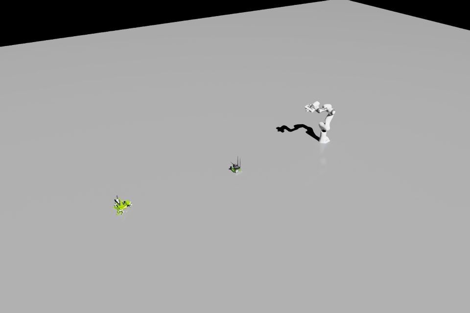
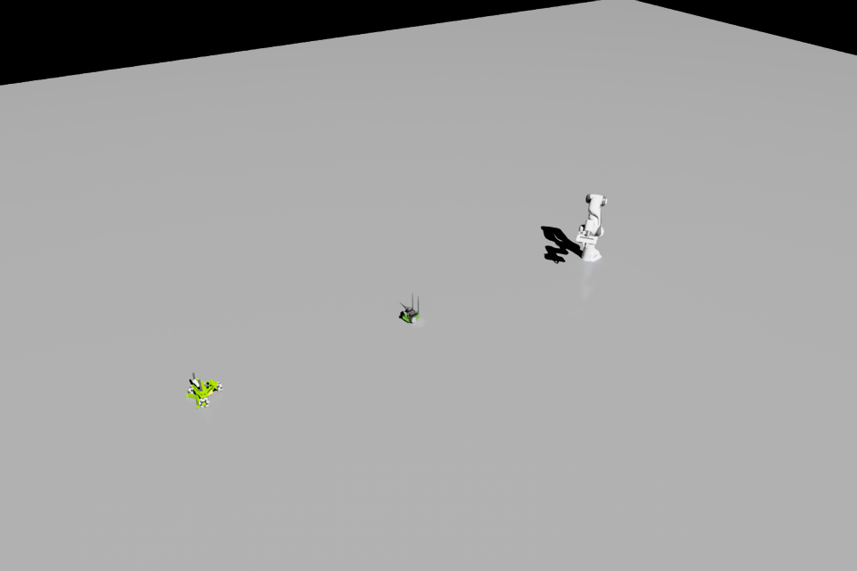

# MCP 6.2 修复后复测

> 本页为上一轮记录。最新完整范围验收见 [MCP_6_2_ACCEPTANCE.md](MCP_6_2_ACCEPTANCE.md)：
> 人物、ROS 2、MPM / 保存桥接已补齐；仅保留用户明确排除的 USD Search / Beaver3D 未验收。

日期：2026-11-12。修复基线：`0a34263`。本记录接续并更新初轮 `FULL_MCP_6_2_VALIDATION.md` 的结论。

## 结果

- **701 项离线测试通过，53 项按 live / Unix launcher 标记排除；0 失败。**
- **本轮 28 个实机回归域最终全部通过**，包括之前失败的 Panda + Jetbot + Kaya 混合 GPU 场景。
- 全仓库 Ruff、`git diff --check` 通过。
- 实际宿主为 **Isaac Sim 6.2.0-rc.14 / Windows / PhysX**，专用端口 19876；HTTP 专项使用 19977。
- 未切换 CPU 来规避混合场景故障。GPU dynamics 与 GPU broadphase 均由读回确认。
- 只修改本 MCP 仓库。外部 MPM、保存插件未启用、未修改；未修改 NVIDIA 安装文件、驱动或用户正式场景。
- 本轮不推送、不打标签、不发布；仅维护本地 `main`。

这里的“全部通过”指本轮列出的 28 个验收域，不是全部外部集成都已验证。
初轮 138 个 legacy 工具中，114 个已有成功实机覆盖；24 个外部依赖相关工具的正向验收仍未执行：
人物/导航 9、ROS 2 发布/删除 6、MPM 5、源文件保存桥接 2、USD Search / Beaver3D 2。
这些功能仍受未启用插件或缺少 API 配置限制；本轮没有为了消除这个限制去动其他插件。

## 修复与根因证据

### 1. 创建机器人时隐式初始化物理

基线在干净进程仍能复现 CUDA 700。`robots.create` 创建每个资产后读取关节信息与驱动配置，
这些元数据读取原先会调用 `_ensure_physics_world()`，导致时间轴虽显示 stopped，原生物理却已启动；
之后再加入第二、第三个 articulation，进入不一致的 GPU 场景生命周期。

修复后：

- 停止态的关节发现使用 USD articulation 属性查询，不创建物理 SimulationView。
- 驱动配置读取、停止态驱动配置写入不再预热物理。
- 停止态 `get_joint_config` 返回 authored 配置，不伪造 `actual_position` / `position_error`；
  revolute authored target 同步统一为弧度。
- playing / paused 的实际关节读回仍使用运行时 tensor；没有取消正常的显式 Play / Step 初始化。

实机逐次创建 Panda、Jetbot、Kaya 并查询元数据后，均断言 timeline stopped 且 SimulationView 不存在。
随后显式启动，同一混合场景通过，未再出现 CUDA 700。
这与官方关于初始化会启动物理引擎的契约一致：
[SimulationManager 6.2 API](https://docs.isaacsim.omniverse.nvidia.com/6.2.0/py/source/extensions/isaacsim.core.simulation_manager/docs/api.html)。

### 2. Kaya 指令成功但实际运动不正确

消除 CUDA 故障后，新增车体位移验收发现旧 QP 路线下，Kaya 轮速读回非零但两秒后车体只平移约 0.0021 m，主要在旋转。
因此没有把“接口成功、轮子转了”当作验收通过。

6.2 路线改用安装中已有的 `isaacsim.robot_motion.controllers.HolonomicController`，
按官方 `RobotState` / `SpatialState` body-twist 接口传入 forward、lateral、yaw，再按关节名映射结果。
MCP 的 extension.toml 声明该官方依赖；6.0/6.1 既有路线保留，有离线分支测试。
没有修补第三方源码，也没有加入经验性 yaw 缩放常数。
用法依据：[NVIDIA 6.2 Holonomic Tutorial](https://docs.isaacsim.omniverse.nvidia.com/6.2.0/controllers/tutorial_holonomic.html)
及本机同名 standalone example。

### 3. 验收脚本修正

- 物理 authoring 测试：先验收 kinematic 配置，再明确改为 dynamic 参与世界关节模拟，避免以不能模拟的 world-to-kinematic joint 充当正例。
- 相机清理：先查询 verifier-owned prim 是否存在，避免对不存在的初始对象发删除命令而制造 Kit 错误日志。
- 新增混合 GPU verifier：严格检查隔离宿主身份、空 scratch stage、外部 provider 禁用状态，
  再检查 GPU 配置、创建期间无物理预热、关节/轮速、车体位移、停止后的实际轮速和两帧原生 MCP 图片。

## 实测数值与画面

新控制器验证使用 forward 0.1 m/s，Jetbot / Kaya yaw 0.1 rad/s，Kaya lateral 0.05 m/s；
暂停后精确步进 120 帧（60 Hz）。指令下发阶段也有少量正常 Play 更新，因此位移不是严格两秒积分精度测试。

| 读回 | 结果 |
|---|---:|
| Panda joint1，目标 0.7 rad | 0.69949 rad |
| Jetbot 刚体平均平面位移 | 0.22758 m |
| Kaya 刚体平均平面位移 | 0.22674 m |
| 停止目标 | 所有驱动轮速度目标归零 |
| 停止后再步进 120 帧 | 所有驱动轮实际速度绝对值 < 0.1 rad/s |
| 两帧像素差异 | 约 0.77%（广角全场景） |

两张图片由真实 MCP `ImageContent` 返回，已人工查看；三个机器人都在画面中，姿态/位移与读回一致。

| 运动前 | 运动后 |
|---|---|
|  |  |

## 回归范围与日志

逐域结果见 [MCP_6_2_RECHECK_RESULTS.json](MCP_6_2_RECHECK_RESULTS.json)。
覆盖命令治理、任务诊断、USD 组合、刚体/碰撞组/关节、物理材质与参数、OmniGraph、后端能力矩阵、
RGB/多种相机输出、LiDAR 配置与点云、传感器生命周期、artifact 分块/校验/过期/删除、
stdio/HTTP 原生图片、机器人关节与驱动、运动规划与执行、夹爪/底盘、混合 GPU、
Replicator SDG、6.2 workflow、核心工具及合并入口。

原始证据位于 ignored 目录 `test_outputs/mcp-recheck-20261112-135623/`：

- `offline-final2.log` / `.xml`：701 passed / 53 deselected。
- `kit1.log`：本轮修复前 CUDA 700 复现；保留失败证据。
- `kit3.log`：新控制器和大部分回归。OmniGraph `MCP_ERROR_F` 为故意注入并验证恢复的错误。
  本日志也保留了修正前验收夹具的静态关节/重复删除错误，不能声称整份日志无 error。
- `kit4.log`：正确专项环境下的 artifact、修正后的物理 authoring / 相机 outputs、HTTP；相关复测无 Kit error。
- artifact 首次专项失败是宿主未设置 1024 字节测试上限，HTTP 首次失败是服务端未选择 all domains；
  均修正隔离测试进程环境后通过，没有据此更改产品逻辑或正式配置。
- `mixed-gpu-evidence.json`、`mixed-gpu-result.json`、各域 trace / log、`domains.jsonl` 保存调用和后置条件。
- `before-recheck.bundle` 为修改前 Git 备份；`cleanup.json` 保存停止时间轴、清空 scratch stage、provider 禁用和运行身份读回。

离线重跑命令与初轮记录一致。新实机脚本为 `scripts/verify_multi_robot_gpu_live.py`，必须设置
`ISAAC_MCP_PORT=19876`、`ISAAC_MCP_VALIDATION_ROOT` 为隔离宿主日志和 scratch USD 的共同父目录，
以及 `ISAAC_MCP_TOOL_DOMAINS=all`、`ISAAC_MCP_TOOL_PROFILE=legacy`。
artifact 专项要求**宿主**进程设置 `ISAAC_MCP_ARTIFACT_TTL_SECONDS=30` 和
`ISAAC_MCP_ARTIFACT_MAX_CHUNK_BYTES=1024`；只设置客户端不会改变宿主限制。
